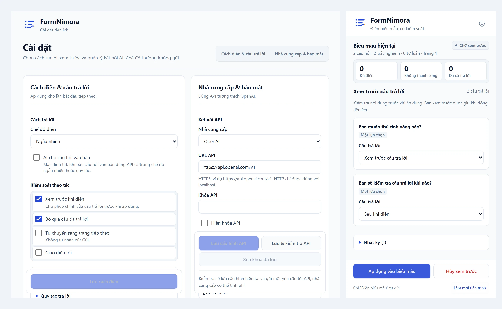

[English](./README.md) | **日本語**

<div align="center">
  
  <h1>FormNimora</h1>
  <p>Google Forms に、ランダム・キーワードルール・AI で回答を入力する Chrome 拡張機能です。</p>
  <p>
    <a href="#ローカルでのインストール">インストール</a> ·
    <a href="#使い方">使い方</a> ·
    <a href="#ai-の設定任意">AI の設定</a>
  </p>
  <p>
    
    
    
  </p>
</div>

[](./docs/readme/overview.webp)

<p align="center"><sub>設定と回答プレビュー · ローカルのテストフォームを使った実際の拡張機能の画面です · クリックで拡大</sub></p>

## 主な機能

- ラジオボタン、チェックボックス、プルダウン、均等目盛、グリッド、テキストの質問に対応します。
- 入力前に回答をプレビュー・編集でき、回答済みの質問はスキップできます。
- OpenAI 互換の Chat Completions API による AI 回答を利用できます。
- セクションの自動移動、進捗表示、停止ボタンを備えています。
- 専用の **Điền biểu mẫu** ボタンでは、確認後にランダム入力と指定件数（1～100 件）の回答送信を行います。

## ローカルでのインストール

Chrome 120 以上、Node.js 22 以上、npm が必要です。

```sh
npm ci
npm run build
```

1. `chrome://extensions` を開き、**デベロッパー モード**を有効にします。
2. **パッケージ化されていない拡張機能を読み込む**から、プロジェクトの `dist` フォルダーを選びます。
3. Google Forms の回答ページ（`https://docs.google.com/forms/.../viewform`）を開き、拡張機能のアイコンからサイドパネルを開きます。

コード変更後は、再ビルド、拡張機能の再読み込み、フォームのタブの再読み込みが必要です。

## 使い方

1. **Quét câu hỏi** で現在のセクションの質問を読み取ります。
2. ランダム・ルール・AI のいずれかを選びます。
3. **Chuẩn bị câu trả lời** で回答を準備し、プレビュー確認後に **Áp dụng vào biểu mẫu** で入力します。
4. フォームを確認し、手動で送信します。通常の入力では**自動送信しません**。

> [!WARNING]
> **自動送信では実際の回答が送信されます。** **Điền biểu mẫu** は、自分が所有するフォームか、テストの許可を得たフォームでのみ使用してください。停止しても送信済みの回答は取り消せません。停止・リセットでは入力済みの回答を消去しません。エラー時は処理を停止し、送信を自動で再試行しません。

### AI の設定（任意）

**Cài đặt** を開き、利用するプロバイダーの Base URL、API キー、モデルを入力して保存・接続テストを行います。確認画面で API ホストへのアクセスを許可してください。OpenAI Chat Completions 互換のエンドポイントが必要です。Gemini ネイティブ API とストリーミングには対応していません。

AI を使うと、現在の質問、該当する選択肢、明示的に入力した個人情報・補足情報が設定先のプロバイダーに送られます。テキスト質問への AI 回答は初期状態では無効です。生成内容を確認してください。API の利用には料金が発生する場合があります。

> [!IMPORTANT]
> **API キーは `chrome.storage.local` に保存され、初期状態では暗号化されません。** Content script はこのストレージを読み取れず、API 通信はバックグラウンドの service worker が行います。共有端末では権限の強いキーを使わないでください。キーを削除しても API ホストへのアクセス許可は解除されないため、Chrome で管理してください。

## 既知の制約

- Google Forms の回答ページが対象です。編集画面では動作しません。Google Forms へのアクセス権限が必要で、AI ホストへの権限は別途要求します。
- 日付・時刻、ファイルのアップロード、「その他」の追加入力、列の重複を禁止するグリッドには完全対応していません。CAPTCHA や認証を回避する機能はありません。
- 必須のテキスト質問には、事前入力または AI の有効化が必要です。Google Forms の入力検証や DOM の変更によって処理が中断する場合があります。重要なデータに使う前に動作を確認してください。

## 開発

TypeScript · React 19 · Tailwind CSS 4 · Vite · Chrome Manifest V3。

```sh
npm test       # Scanner、planner、engine、API、UI のテスト
npm run build # 型チェックと拡張機能のビルド
npm run dev   # UI プレビュー: /popup.html、/options.html
```

開発サーバーは UI のプレビュー専用です。Chrome API の利用には拡張機能のインストールが必要です。`src/content/` がフォームの解析・入力、`src/background/` がメッセージ処理・API 通信、`src/popup/` と `src/options/` が UI を担当します。
